<div align="center">


<a href="https://github.com/Casper-Tech-ke/cfdns"></a>

<br>


<br><br>

A small command-line tool to create and manage Cloudflare DNS records from your server's terminal.



</div>

## Features

- Add, update, list, and delete DNS records (A, AAAA, CNAME, TXT, MX, and more)
- Switch the Cloudflare proxy (orange/grey cloud) with one command
- Short names: `cfdns add api` becomes `api.yourdomain.com`
- Zone guard: refuses any name outside your own domain
- Confirmation prompt before every update and delete
- Ambiguity protection: if a name has several records, it asks you to narrow it down instead of guessing
- One-line install with an interactive setup

## Requirements

- A server running Debian or Ubuntu, with root access
- A domain on Cloudflare
- `curl` and `jq` (the installer sets these up for you)

## Installation

Run this on your server:

```bash
curl -fsSL https://raw.githubusercontent.com/Casper-Tech-ke/cfdns/main/install.sh | bash
```

The installer will:

1. Install the dependencies
2. Install the `cfdns` command to `/usr/local/bin`
3. Ask for your Cloudflare **API token** and **Zone ID**, save them, and verify the connection

### Getting your API token

1. Go to https://dash.cloudflare.com/profile/api-tokens
2. Click **Create Token** and use the **Edit zone DNS** template
3. Choose your domain under **Zone Resources**
4. Create the token and copy it (it is only shown once)

### Getting your Zone ID

Open your domain in the Cloudflare dashboard. The Zone ID is on the **Overview** page, in the right sidebar under **API**.

Your token and Zone ID are saved only on your server, in `/root/.cfdns.env` (permissions `600`). They are never stored in this repository.

## Usage

```bash
cfdns                 # show the banner and help
cfdns verify          # check the token and zone
cfdns list            # show all records
```

### Commands

| Command | What it does |
|---|---|
| `cfdns verify` | Checks your token and shows the zone name |
| `cfdns list` | Lists all records with type, value, proxy status, and priority |
| `cfdns add NAME [VALUE] [flags]` | Creates a record |
| `cfdns update NAME NEWVALUE [flags]` | Changes a record (asks to confirm) |
| `cfdns proxy NAME [on\|off]` | Shows or switches the proxy |
| `cfdns delete NAME [flags]` | Removes a record (asks to confirm) |
| `cfdns site NAME PORT` | Creates the DNS record and Caddy config in one step |
| `cfdns site list` / `site remove NAME` | Shows or removes sites managed by cfdns |

### Flags

| Flag | Meaning |
|---|---|
| `--type T`, `-t T` | Record type (A, AAAA, CNAME, TXT, MX, ...). Default for `add` is `A` |
| `--priority N` | MX priority (defaults to 10 for MX records) |
| `--match TEXT`, `-m TEXT` | Pick one record when a name has several (matches part of its value) |
| `--proxy`, `-p` | Orange cloud (proxied) |
| `--dns-only`, `-d` | Grey cloud (DNS only) |
| `--keep-dns` | With `site remove`: keep the DNS record |

### Naming

`NAME` can be short (`api`), full (`api.yourdomain.com`), or `@` for the root domain.

## Examples

### A records

```bash
cfdns add myapp                       # points to this server's IP, proxied
cfdns add myapp --dns-only            # grey cloud
cfdns add myapp 1.2.3.4 --proxy       # custom IP
cfdns update myapp 5.6.7.8
```

### CNAME

```bash
cfdns add www yourdomain.com --type CNAME
```

### TXT (quote the value)

```bash
cfdns add @ "v=spf1 include:mailgun.org ~all" --type TXT
cfdns add _dmarc "v=DMARC1; p=none" --type TXT
```

### MX

```bash
cfdns add @ mx.example.com --type MX --priority 10
cfdns add @ mx2.example.com --type MX --priority 20
```

### Proxy

```bash
cfdns proxy myapp          # show current state
cfdns proxy myapp on       # orange cloud
cfdns proxy myapp off      # grey cloud
```

### Changing or removing one of several records

A name like `@` can hold many records at once. Use `--type` and `--match` to say which one you mean:

```bash
cfdns update @ "v=spf1 -all" --type TXT --match spf1
cfdns delete @ --type MX --match mx2
```

If you don't narrow it down, `cfdns` lists the candidates and stops.

## Safety

- **Zone guard:** a name that ends outside your domain (e.g. `test.other.com`) is refused.
- **Confirmation:** `update` and `delete` show exactly what will change and wait for you to type `yes`.
- **No guessing:** if more than one record matches, nothing is changed.
- **Proxy rules:** only A, AAAA, and CNAME records can be proxied. Other types are always DNS only.

## Cloudflare SSL/TLS settings

`cfdns` only manages DNS records. SSL/TLS settings are changed in the Cloudflare dashboard, because the API token only has DNS permission. They matter when a record is **proxied** (orange cloud). DNS-only (grey cloud) records bypass Cloudflare, so your server's own certificate is all that counts.

### 1. Encryption mode

Go to **SSL/TLS → Overview** and choose:

| Mode | What it does | Use it? |
|---|---|---|
| Off | No encryption at all | No |
| Flexible | Encrypted to the visitor, **plain HTTP to your server** | No. Causes "too many redirects" with Caddy or Nginx |
| Full | Encrypted to your server, any certificate accepted (even self-signed) | Only as a temporary fallback |
| **Full (strict)** | Encrypted to your server, certificate must be valid and trusted | **Yes, recommended** |

Caddy gets a free trusted certificate (Let's Encrypt) for every domain in your Caddyfile automatically, so **Full (strict)** works with no extra setup.

### 2. Edge Certificates

Go to **SSL/TLS → Edge Certificates** and set:

| Setting | Value | Why |
|---|---|---|
| Always Use HTTPS | On | Redirects `http://` visitors to `https://` |
| Minimum TLS Version | TLS 1.2 | Blocks old, insecure clients |
| Automatic HTTPS Rewrites | On | Fixes mixed-content links on your pages |
| HSTS | Optional | Forces browsers to use HTTPS. Only enable once HTTPS works everywhere, because it is hard to undo |

### Optional: Cloudflare Origin Certificate

Instead of Caddy's automatic certificate, you can create a 15-year certificate under **SSL/TLS → Origin Server → Create Certificate**, save the two files on your server, and point Caddy at them:

```
myapp.yourdomain.com {
    tls /etc/ssl/cloudflare/cert.pem /etc/ssl/cloudflare/key.pem
    reverse_proxy localhost:3001
}
```

This certificate is trusted by Cloudflare only, so it works for proxied records but not for DNS-only ones.

### SSL error codes

| Code | Meaning | Fix |
|---|---|---|
| 521 | Server refused the connection | Check Caddy is running and ports 80/443 are open |
| 525 | SSL handshake failed | Your server has no valid HTTPS setup. Check Caddy's logs |
| 526 | Invalid certificate (Full strict) | Wait for Caddy to finish getting its certificate, or use a valid origin certificate |
| Too many redirects | Mode is Flexible | Switch to Full (strict) |

If Caddy can't get its certificate on a brand-new domain, turn the proxy off for a minute (`cfdns proxy myapp off`), let Caddy get the certificate, then turn it back on (`cfdns proxy myapp on`).

## Making a subdomain live

One command creates the DNS record, adds the Caddy config, checks it, and reloads Caddy:

```bash
cfdns site myapp 3001
```

That makes `myapp.yourdomain.com` serve whatever app is running on port 3001.

```bash
cfdns site myapp 3001 --dns-only    # grey cloud instead of proxied
cfdns site list                     # show sites managed by cfdns
cfdns site remove myapp             # remove the Caddy block and the DNS record
cfdns site remove myapp --keep-dns  # remove only the Caddy block
```

**Requirements:** Caddy installed (`apt install -y caddy`), ports 80 and 443 open on your server, and Cloudflare **SSL/TLS** set to **Full (strict)** (see [Cloudflare SSL/TLS settings](#cloudflare-ssltls-settings)).

**Safety:** `site` asks for confirmation, backs up the Caddyfile to `/etc/caddy/Caddyfile.cfdns.bak`, validates the new config before reloading, and rolls back automatically if Caddy rejects it. It never overwrites an existing hostname or DNS record. Blocks it creates are wrapped in `# cfdns:begin` and `# cfdns:end` markers, so it only removes what it added.

### Doing it by hand

If you prefer manual steps:

1. `cfdns add myapp`
2. Add to `/etc/caddy/Caddyfile`:
   ```
   myapp.yourdomain.com {
       reverse_proxy localhost:3001
   }
   ```
3. `systemctl reload caddy`

## Updating

```bash
curl -fsSL https://raw.githubusercontent.com/Casper-Tech-ke/cfdns/main/cfdns -o /usr/local/bin/cfdns && chmod +x /usr/local/bin/cfdns
```

Your saved token and Zone ID are kept.

## Uninstalling

```bash
rm /usr/local/bin/cfdns /root/.cfdns.env
```

## Troubleshooting

| Problem | Fix |
|---|---|
| `Could not read your zone` | Re-run the installer and re-enter a valid token and Zone ID |
| `Refusing: ... is outside your zone` | Use a short name (`api`) or a name ending in your domain |
| `has N matching records` | Add `--type` and/or `--match` to pick one |
| `Failed: Authentication error` | The token is wrong or lacks permission. Create a new one with the Edit zone DNS template |
| `502` after going live | The app is not running on that port. Check `pm2 status` |
| `521` | Cloudflare can't reach your server. Check Caddy and ports 80/443 |
| `525` / `526` | SSL mode mismatch. Use Full (strict) with a valid certificate on the server |
| "Too many redirects" | SSL mode is Flexible. Switch to Full (strict) |

## Limitations

- One zone (domain) per installation
- Records are managed by name, so use `--type` and `--match` when a name has several

## Security

Found a vulnerability? Please report it privately. See [SECURITY.md](SECURITY.md) for how, what is in scope, and tips for keeping your token safe.

## License

Released under the [MIT License](LICENSE). Copyright (c) 2026 XSPACE TECH DEVS.

## Acknowledgments

See [ACKNOWLEDGMENTS.md](ACKNOWLEDGMENTS.md) for credits and the tools this project is built on.

<div align="center">

---

Created & maintained by **XSPACE TECH DEVS** | GitHub: [Casper-Tech-ke](https://github.com/Casper-Tech-ke)

</div>
